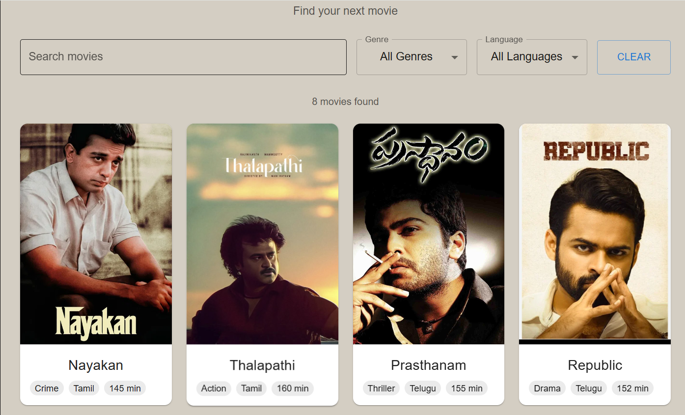
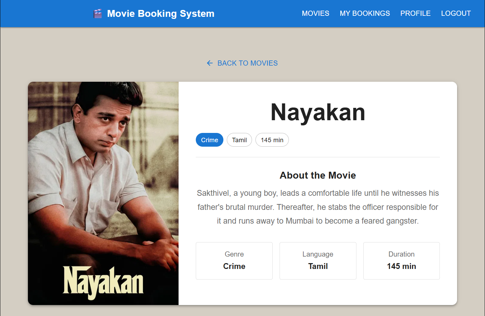
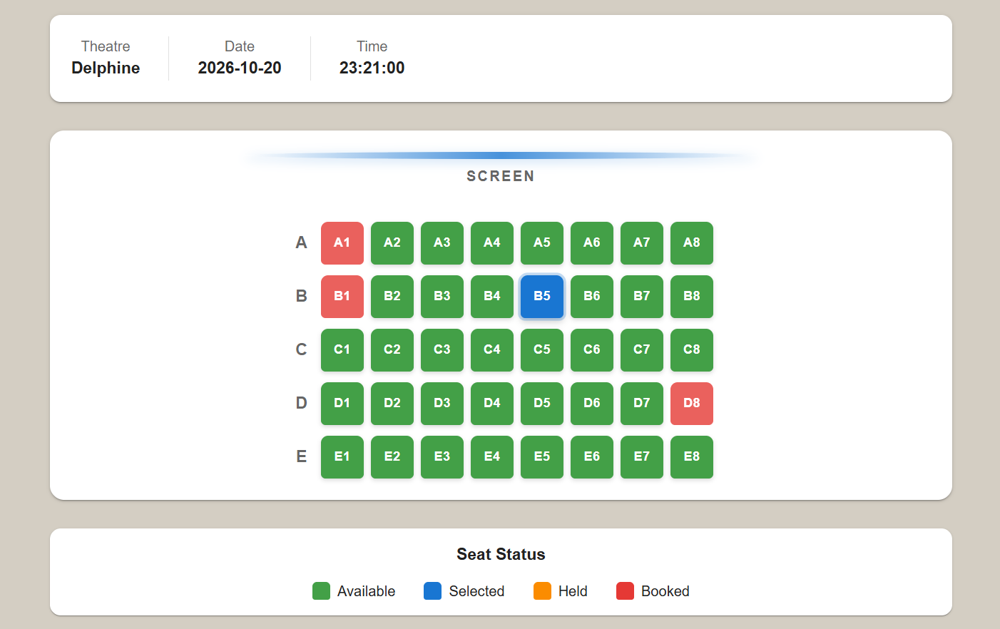
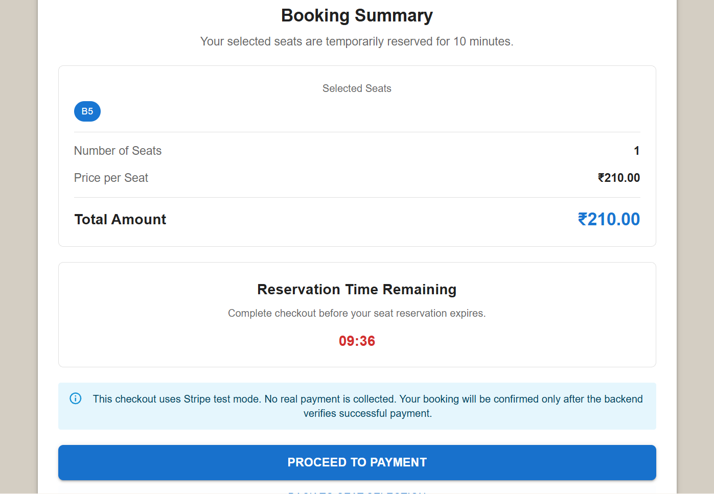
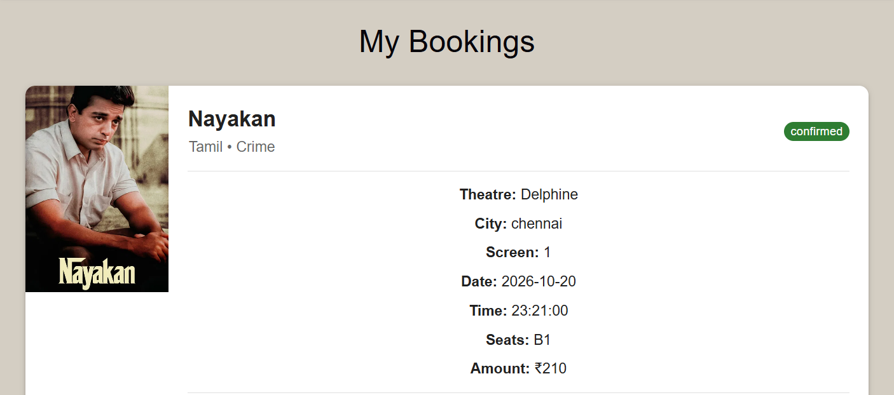

# Real-Time Movie Ticket Booking System

A web application for booking movie tickets, built with **Django REST Framework, React TypeScript, and MongoDB**. The application provides movie browsing, interactive seat selection, temporary seat reservations, secure Stripe payment integration, and automatic booking confirmation.

## Features

- 🎬 Browse movies and available showtimes
- 🎫 Interactive seat selection
- 🔒 Temporary seat reservation to prevent double booking
- 💳 Secure payment processing with Stripe Checkout
- 👤 User authentication with Firebase
- 📱 Responsive user interface with Material UI
- 📖 View personal booking history
- 🎯 Real-time seat availability management
- 🔄 Automatic booking confirmation through Stripe webhooks
- ⏱️ Seat reservation expiry and automatic release
- ✅ Payment status verification and booking confirmation

## UI Screenshots

### Home Page


### Movie Details


### Seat Selection


### Checkout


### My Bookings


## Tech Stack

### Backend

- Python
- Django REST Framework
- MongoDB
- Firebase Admin SDK
- Stripe Python SDK

### Frontend

- React
- TypeScript
- Material UI (MUI)
- React Router
- Axios
- Firebase Authentication

## Project Structure

```text
Movie-Ticket-Booking-System/
│
├── backend/
│   ├── bookings/          # Booking and payment processing
│   ├── movies/            # Movie management
│   ├── shows/             # Showtime management
│   ├── seats/             # Seat selection and reservation
│   ├── users/             # User authentication and management
│   ├── common/            # Shared utilities and MongoDB connection
│   ├── manage.py
│   └── requirements.txt
│
├── frontend/
│   ├── public/
│   ├── src/
│   │   ├── components/    # Reusable UI components
│   │   ├── pages/         # Application pages
│   │   ├── layouts/       # Application layouts
│   │   ├── routes/        # Route configuration
│   │   ├── services/      # API and payment services
│   │   └── firebase/      # Firebase configuration
│   └── package.json
│
└── README.md
```

## Setup

### Prerequisites

- Python 3.x
- Node.js and npm
- MongoDB
- Firebase account
- Stripe account
- Stripe CLI

### Backend Setup

1. Navigate to the backend directory:

```bash
cd backend
```

2. Create and activate a virtual environment:

```bash
python -m venv venv
```

**Windows:**

```bash
venv\Scripts\activate
```

3. Install dependencies:

```bash
pip install -r requirements.txt
```

4. Configure your backend `.env` file with the required credentials.

5. Run Django migrations:

```bash
python manage.py migrate
```

6. Start the backend server:

```bash
python manage.py runserver
```

Backend runs at:

```text
http://127.0.0.1:8000/
```

### Frontend Setup

1. Open another terminal and navigate to the frontend directory:

```bash
cd frontend
```

2. Install dependencies:

```bash
npm install
```

3. Configure your Firebase environment variables in the frontend `.env` file.

4. Start the development server:

```bash
npm run dev
```

Frontend runs at:

```text
http://localhost:5173/
```

## Environment Variables

### Backend (.env)

- `SECRET_KEY` – Django secret key
- `DEBUG` – Django debug mode
- `ALLOWED_HOSTS` – Allowed host configuration
- `MONGODB_URI` – MongoDB connection string
- `FIREBASE_*` – Firebase Admin SDK configuration
- `STRIPE_SECRET_KEY` – Stripe test secret key
- `STRIPE_WEBHOOK_SECRET` – Stripe webhook signing secret
- `FRONTEND_URL` – Frontend application URL

### Frontend (.env)

- `FIREBASE_API_KEY`     – Firebase API key
- `FIREBASE_AUTH_DOMAIN` – Firebase authentication domain
- `FIREBASE_PROJECT_ID`  – Firebase project ID
- `FIREBASE_APP_ID`      – Firebase application ID

## Real-Time Features

- 🎫 **Dynamic Seat Availability:** Seat availability is managed by the backend and updated when seats are reserved, released, or booked.
- 🔒 **Temporary Seat Locking:** Selected seats are temporarily reserved for fixed time frame, preventing other users from booking the same seats during the reservation period.
- ⚡ **Concurrent Booking Prevention:** Backend validation ensures that only the user holding the active reservation can confirm the selected seats.
- ⏱️ **Automatic Reservation Expiry:** Expired seat reservations are automatically released and made available for other users.
- 💳 **Real-Time Payment Verification:** Stripe webhooks notify the backend about payment events, allowing payment status to be verified.
- 🔄 **Automatic Booking Confirmation:** Once successful payment is verified, the backend creates the booking and updates the seat status in MongoDB.
- 📊 **Payment Status Tracking:** The Payment Result page checks the backend for payment confirmation and displays pending, successful, or failed status.
- 🛡️ **Secure Booking Validation:** Firebase authentication and backend ownership checks ensure users can access only their own payment information and reservations.